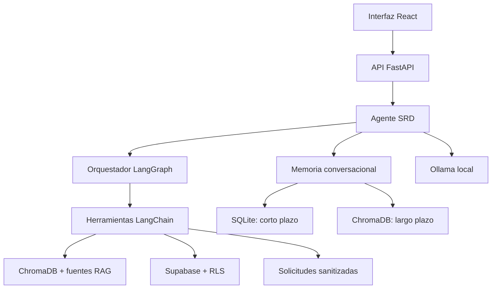
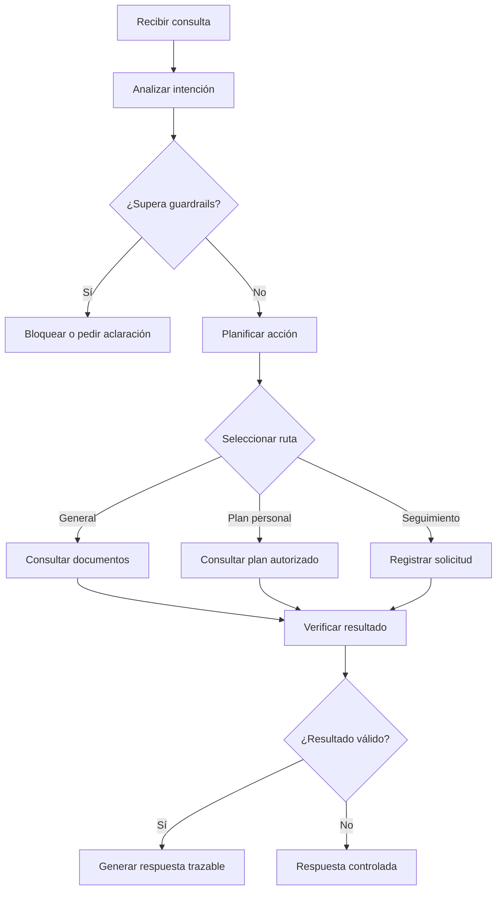

# Arquitectura y orquestación — EP2

## Propósito

SRD Asistente utiliza un agente informativo que selecciona herramientas según la intención de la consulta. El agente puede recuperar documentos, consultar el plan autorizado de un paciente o registrar una solicitud para revisión profesional. No diagnostica, no prescribe ejercicios y no modifica tratamientos.

## Arquitectura general

## Flujo de planificación

## Rutas del agente

| Ruta | Condición principal | Herramienta | Resultado esperado |
|---|---|---|---|
| Documental | Consulta general sobre ejercicios, protocolos o fuentes oficiales | `consultar_documentos` | Documentos autorizados para construir una respuesta RAG |
| Plan personal | Consulta sobre ejercicios, sesiones, frecuencia o repeticiones asignadas | `consultar_plan_personal` | Contexto del paciente permitido por JWT, rol y RLS |
| Seguimiento | Solicitud explícita para contactar o avisar al kinesiólogo | `registrar_solicitud` | Solicitud sanitizada con estado `pending_review` |
| Bloqueada | Decisión clínica, datos ajenos o acción no autorizada | Ninguna | Rechazo seguro antes de ejecutar herramientas |
| Evidencia insuficiente | La herramienta no encuentra información válida | Ninguna adicional | Respuesta controlada que reconoce la falta de respaldo |
| Error | Herramienta ausente, excepción o resultado inválido | Ninguna adicional | Mensaje seguro sin inventar información |

## Estado administrado por LangGraph

El orquestador mantiene un estado tipado durante cada consulta. Este contiene:

- Pregunta original.
- Identificador opcional del paciente.
- Intención detectada.
- Herramienta seleccionada.
- Argumentos enviados a la herramienta.
- Resultado estructurado.
- Ruta adoptada.
- Cantidad de acciones ejecutadas.
- Advertencias y errores controlados.

## Límite de acciones

Cada consulta permite como máximo cuatro acciones. Antes de ejecutar una herramienta, el orquestador compara `action_count` con `max_actions`. Si el límite fue alcanzado, detiene el flujo y devuelve una respuesta controlada.

En la implementación actual normalmente se ejecuta una herramienta por consulta. El límite de cuatro acciones evita ciclos o ejecuciones excesivas y permite ampliar el flujo posteriormente sin perder control.

## Memoria y contexto

La memoria de corto plazo conserva seis mensajes recientes por `conversation_id` en SQLite. La memoria de largo plazo usa una colección independiente de ChromaDB y recupera preferencias explícitas mediante similitud semántica.

Los recuerdos se aíslan con un hash del usuario. No se guardan diagnósticos, síntomas, tratamientos, credenciales ni datos clínicos inferidos.

## Controles de seguridad

- Validación del usuario autenticado.
- Separación de permisos por rol.
- Aplicación de políticas RLS en Supabase.
- Guardrails antes de ejecutar herramientas.
- Argumentos validados con Pydantic.
- Máximo de cuatro acciones por consulta.
- Verificación del estado retornado por cada herramienta.
- Respuestas controladas ante errores o falta de evidencia.
- Trazas con identificadores anonimizados.
- Sin modificación automática de tratamientos.

## Evidencia automatizada

Las rutas del orquestador se validan en:

- `rag_service/tests/test_orchestrator.py`
- `rag_service/tests/test_agent_orchestration.py`
- `rag_service/evidence/ep2/resultados-orquestacion.txt`

Las pruebas cubren consulta documental, plan personal, registro de solicitudes, bloqueo clínico, acceso no autorizado, evidencia insuficiente, errores y límite de acciones.