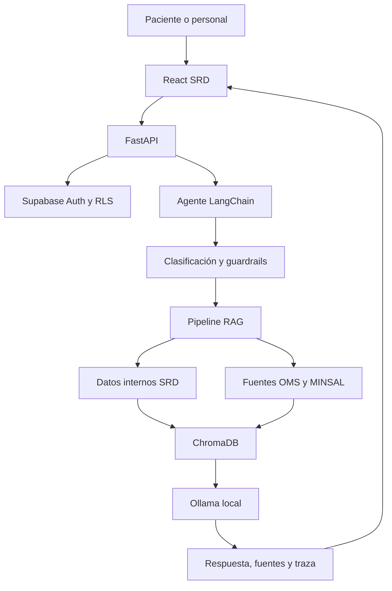

# Arquitectura de SRD Assist

## Flujo

1. React envía la consulta junto al JWT vigente de Supabase.
2. FastAPI valida la sesión y obtiene el rol desde `profiles`.
3. Los guardrails deterministas bloquean solicitudes críticas antes del modelo.
4. LangChain reformula consultas dependientes del historial.
5. Chroma recupera fragmentos internos y externos mediante embeddings de Ollama.
6. Para planes personales, FastAPI consulta Supabase usando el JWT del usuario; RLS conserva el alcance autorizado.
7. El LLM `llama3.2:3b` genera una respuesta solo desde el contexto recuperado.
8. La API devuelve respuesta, fuentes, intención, tiempo y un identificador de traza.

## Límites de confianza

- El navegador no decide el rol: el backend lo obtiene desde Supabase.
- El LLM no decide el acceso: Supabase RLS y Python lo aplican primero.
- El contexto personal no se guarda en ChromaDB.
- Las trazas utilizan un hash del identificador del usuario y no almacenan la consulta clínica.
